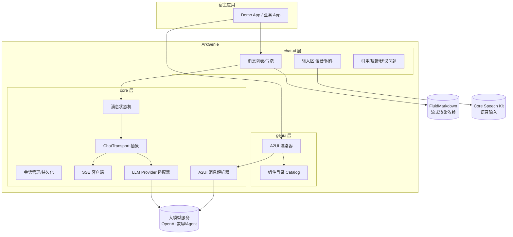

# ArkGenie —— ArkUI 生成式 AI 对话组件套件：需求与开发方案设计

> 版本：v1.0 草案（2026-10）
> 目标：2026 年内上架 OHPM + GitCode/Gitee/GitHub，达成鸿蒙极客"开源贡献"维度（OHPM like≥50 或 Git star≥35），并作为 AI 助手挑战赛的参赛作品载体。

---

## 1. 项目定位

### 1.1 一句话定位

**HarmonyOS 上首个兼容 A2UI 协议的"AI 对话 + 生成式 UI"全栈开源组件套件**：让鸿蒙开发者用十几行代码，把"接大模型的智能对话界面"完整装进自己的应用。

### 1.2 命名建议

- 仓库名：`ark-genie`（ArkUI + Genie，生成式 AI 寓意）
- OHPM 包名：`@arkgenie/core`、`@arkgenie/chat-ui`、`@arkgenie/genui`
- 备选：`harmony-aichat-kit`、`ohos-genui`

### 1.3 成功指标（北极星）

| 指标 | 2026 年内目标 | 对应激励 |
|---|---|---|
| OHPM like | ≥ 50 | 开源贡献达标线 |
| GitCode/Gitee star | ≥ 35 | 开源贡献达标线（二选一） |
| 每季度发版 | ≥ 1 次 | 激励硬性要求 |
| 实战文章 | ≥ 3 篇（华为社区/掘金/CSDN） | 技术分享/内容贡献联动 |
| Demo 应用上架 | 1 个（AI 助手示例） | 可叠加挑战赛高阶赛道 |

---

## 2. 现状调研与竞争分析

### 2.1 鸿蒙生态现有玩家（2026-10 调研）

| 项目 | 类型 | 覆盖能力 | 局限 | 热度 |
|---|---|---|---|---|
| **Copilot 智能聊天组件**（华为生态市场） | 聊天 UI 组件 | 对接 DeepSeek/Qwen、Agent 模式、function 事件、卡片 | 生态市场闭源组件、定制能力有限、非开源 | like 81 |
| **FluidMarkdown 鸿蒙版**（支付宝开源） | 流式 Markdown 引擎 | CommonMark 全语法、LaTeX、表格、流式/全量双模式、无回流逐字渲染 | 只做 Markdown 渲染，不含对话框架 | 官方媒体背书，热度高 |
| **ChatUI**（@changwei/chatui） | 聊天 UI 框架 | 基础对话组件开箱即用 | 无流式、无 AI 场景能力（引用/工具调用/语音）、更新不活跃 | 一般 |
| **openai_ohos** | SDK 适配库 | OpenAI SDK 的鸿蒙适配、SSE 流式、请求取消 | 只解决"调 API"，不解决 UI | 一般 |
| **markdown_hm / 仓颉 Markdown 引擎** | Markdown 渲染 | 语法渲染；仓颉引擎被 Kimi 鸿蒙版采用，滑动帧率提升 2.4 倍 | 单点能力 | 中 |
| **官方 SSE 封装实践**（社区文章） | 教程 | 手把手封装流式 AI 控件 | 说明"ArkTS 原生不支持 SSE、官方推荐库不满足定制需求"仍是真实痛点 | — |

**跨平台参照系**（定义了 2026 年这类库的"及格线"）：

- **Flutter AI Toolkit**：LLM provider 抽象 + 聊天窗口开箱即用
- **flutter_gen_ai_chat_ui**：字/词级流式动画、Markdown 流式
- **ai_chat_kit**：SSE 流式 + 语音输入 + Markdown/代码/表格/LaTeX + 会话持久化
- **Flutter GenUI SDK**：Google 推出的生成式 UI 编排层（Catalog + SurfaceController）
- **A2UI 协议**：Agent 以声明式消息生成界面，客户端从"预批准组件目录"渲染，**不传输可执行代码**；已兼容 A2A / AG-UI / REST 三种传输

### 2.2 关键结论：缺口在哪里

1. **没有"A2UI / 生成式 UI"的鸿蒙实现**。A2UI 是 2026 年 Agent 应用层的标准方向（Google 主推、AG-UI 生态已集成），Flutter 有 GenUI，鸿蒙空白——这是本项目最大的差异化卖点，也是"AI 集成"关键词的最佳命中点。
2. **现有方案全是"零件"，没有"整车"**。Markdown 渲染（FluidMarkdown）、API 调用（openai_ohos）、基础气泡（ChatUI）各自为战，开发者要自己拼装传输层、状态机、UI、持久化。
3. **闭源组件不可定制**。Copilot 组件在生态市场闭源分发，企业客户要改主题/埋点/协议都受限。
4. **SSE 流式在鸿蒙仍是痛点**。官方社区文章标题即"找不到合适的鸿蒙 SSE 库"。

### 2.3 差异化定位

| 维度 | Copilot 组件 | FluidMarkdown | ChatUI | **ArkGenie** |
|---|---|---|---|---|
| 开源可定制 | ❌ | ✅（仅渲染层） | ✅ | ✅ 全栈开源 |
| 流式对话框架 | 部分 | ❌ | ❌ | ✅ 核心能力 |
| 生成式 UI（A2UI） | ❌ | ❌ | ❌ | ✅ **独家** |
| 工具调用/Agent 可视化 | 部分 | ❌ | ❌ | ✅ |
| 语音/附件输入 | 部分 | ❌ | ❌ | ✅ |
| 会话持久化 | ❌ | ❌ | ❌ | ✅ |

**一句话竞争策略**：不与 FluidMarkdown 拼 Markdown 引擎（可依赖/兼容它），不与 Copilot 拼"官方"，做**鸿蒙的 A2UI + 全栈 AI 对话框架**——"Flutter 有 GenUI，鸿蒙有 ArkGenie"。

---

## 3. 需求分析

### 3.1 目标用户与场景

| 用户 | 场景 |
|---|---|
| 鸿蒙应用开发者（个人/小团队） | 给已有 App 加"AI 助手"入口页 |
| 企业开发团队 | 智能客服、办公 Copilot，要求主题/协议可定制 |
| Agent 应用开发者 | 需要工具调用可视化、HITL 确认、生成式 UI 卡片 |
| 参加鸿蒙赛事的开发者 | 快速搭建 AI 类参赛作品（本项目即示范） |

### 3.2 功能需求（FR）

分层列出，P0 = 首版必须，P1 = 第二个季度版本，P2 = 远期。

#### FR-1 Core 核心层（`@arkgenie/core`）

| 编号 | 需求 | 优先级 |
|---|---|---|
| FR-1.1 | 消息模型：文本/图片/文件/语音/卡片/工具调用/错误，含流式状态字段 | P0 |
| FR-1.2 | 消息状态机：`sending → streaming → done / error / cancelled`，支持中途取消与重试 | P0 |
| FR-1.3 | 传输抽象层 `ChatTransport` 接口 + 内置 SSE 客户端（断线重连、心跳、取消） | P0 |
| FR-1.4 | LLM Provider 抽象：预置 OpenAI 兼容协议适配器（DeepSeek/Qwen/智谱等即兼容） | P0 |
| FR-1.5 | 会话管理：多会话创建/切换/删除，基于用户首选项 + 关系型数据库的持久化 | P0 |
| FR-1.6 | 事件总线：消息发送/接收/工具调用/错误全链路回调（供埋点） | P1 |
| FR-1.7 | A2UI 消息解析器：surface 创建/组件 upsert/数据模型更新三类操作的解析与校验 | P1 |

#### FR-2 对话 UI 层（`@arkgenie/chat-ui`）

| 编号 | 需求 | 优先级 |
|---|---|---|
| FR-2.1 | 消息列表：虚拟化长列表、流式增量刷新（不整页重渲染）、自动跟随滚动/用户上翻暂停跟随 | P0 |
| FR-2.2 | 气泡组件：用户/AI 双样式、时间戳、失败重发、复制/转发/删除长按菜单 | P0 |
| FR-2.3 | 流式渲染：对接 FluidMarkdown（优先）或内置降级渲染器，逐字/逐词两档动画，打字光标 | P0 |
| FR-2.4 | 输入区 Composer：多行输入、发送/停止切换、语音输入按钮（Core Speech Kit）、附件（拍照/相册/文件） | P0 |
| FR-2.5 | 引用与溯源：RAG 场景的引用角标 + 点击展开来源卡片 | P1 |
| FR-2.6 | 反馈组件：赞/踩、重新生成 | P1 |
| FR-2.7 | 欢迎页/建议问题（Suggested Prompts） | P0 |
| FR-2.8 | 深色模式与主题 Token 系统（颜色/圆角/字号可配） | P0 |

#### FR-3 生成式 UI 层（`@arkgenie/genui`）——差异化核心

| 编号 | 需求 | 优先级 |
|---|---|---|
| FR-3.1 | A2UI 兼容渲染器：接收声明式组件描述，从预批准组件目录（Catalog）映射渲染为 ArkUI 组件，**不执行远端代码** | P1 |
| FR-3.2 | 内置 Catalog：卡片、表单、按钮组、日期选择、列表、图表占位等 ≥ 12 种 | P1 |
| FR-3.3 | Catalog 扩展机制：开发者注册自定义组件进目录 | P1 |
| FR-3.4 | 交互回传：生成式 UI 上的用户操作按协议回传给 Agent（闭环） | P1 |

#### FR-4 Agent 可视化层

| 编号 | 需求 | 优先级 |
|---|---|---|
| FR-4.1 | 工具调用卡片：名称/参数/执行状态（进行中/成功/失败）/耗时，可折叠展开 | P1 |
| FR-4.2 | HITL 人工确认组件：危险操作前的确认/拒绝按钮 | P2 |
| FR-4.3 | 思考过程展示（Chain-of-Thought 折叠区） | P1 |

#### FR-5 示例与文档

| 编号 | 需求 | 优先级 |
|---|---|---|
| FR-5.1 | 完整 Demo App：模拟后端 + 可切换真实 API Key | P0 |
| FR-5.2 | README：安装、快速开始、API 文档、示例工程（**激励评审硬性要求**） | P0 |
| FR-5.3 | 中文文档站（VitePress，GitHub Pages/Gitee Pages 托管） | P1 |

### 3.3 非功能需求（NFR）

| 类别 | 要求 |
|---|---|
| 兼容性 | HarmonyOS 5.0+（API 12+），Stage 模型；手机/折叠屏/平板自适应 |
| 性能 | 流式渲染滚动帧率 ≥ 55fps（中端机）；万条消息列表不卡顿（虚拟化） |
| 包体积 | core ≤ 100KB，chat-ui ≤ 300KB（不含 FluidMarkdown 依赖） |
| 稳定性 | 组件内异常不导致宿主 App 崩溃（边界 catch + 错误气泡） |
| 隐私 | 不内置任何埋点上报；API Key 不落盘日志 |
| 工程 | ArkTS 严格模式；单元测试覆盖率核心层 ≥ 60% |

---

## 4. 技术架构设计

### 4.1 分层架构



**关键设计决策**：

1. **三个独立 HAR 包**：`core`（零 UI 依赖，可被命令行/元服务复用）、`chat-ui`、`genui`。用户可只装 core。
2. **Markdown 渲染不自研**：优先声明对 FluidMarkdown 的可选依赖（peerDependency 语义），提供内置简易渲染器做降级，避免与支付宝正面竞争且借其热度。
3. **传输层接口先行**：`ChatTransport` 只定义 `send(messages, callbacks)` 与 `cancel()`，SSE/WebSocket/本地 mock 都是实现。Demo 内置 mock 流式数据源，**评审者无需 API Key 即可体验全部 UI**。
4. **A2UI 安全模型**：严格白名单——只有注册进 Catalog 的组件名才能被渲染，属性值经 schema 校验，这是协议核心卖点，实现时必须完整。
5. **流式性能**：传输层收到的 token 先进入 50ms 节流缓冲，批量提交 UI 更新；长列表用 `LazyForEach` + 组件复用。

### 4.2 消息状态机（core 的灵魂）

```
        ┌──────────┐   send    ┌───────────┐
        │   idle   │ ────────► │  sending  │
        └──────────┘           └─────┬─────┘
                                     │ first token
                                     ▼
              ┌──────────────────────────────────┐
              │            streaming             │◄──┐ token chunk
              └───┬──────────┬───────────┬───────┘   │
        stream end│   error  │   cancel  │           │
                  ▼          ▼           ▼           │
            ┌────────┐  ┌────────┐  ┌───────────┐   │
            │  done  │  │ error  │  │ cancelled │   │
            └────────┘  └───┬────┘  └───────────┘   │
                            │ retry                 │
                            └───────────────────────┘
```

### 4.3 仓库结构（monorepo）

```
ark-genie/
├── core/                  # @arkgenie/core HAR
├── chat-ui/               # @arkgenie/chat-ui HAR
├── genui/                 # @arkgenie/genui HAR
├── entry/                 # 示例应用入口（可上架）
├── docs/                  # VitePress 文档站
├── README.md              # 安装/使用/API/示例（评审硬指标）
├── CHANGELOG.md
└── LICENSE                # Apache-2.0
```

---

## 5. 开发计划（对齐"每季度更新≥1 次"）

> 以季度为发版节奏，每次发版都是一次"更新"打卡。今天是 2026-10，Q4 是首版窗口期。

| 里程碑 | 时间 | 内容 | 发布动作 |
|---|---|---|---|
| **M1 骨架** | 2026 Q4 上半 | core 状态机 + SSE + mock transport；chat-ui 消息列表/气泡/输入区；README 骨架 | GitCode/Gitee 建仓，v0.1 |
| **M2 可用版** | 2026 Q4 末 | 流式渲染（FluidMarkdown 接入）、Demo App 完整可跑、建议问题/深色模式 | **v1.0 上架 OHPM** + 第一篇文章 |
| **M3 差异化** | 2027 Q1 | genui 包：A2UI 渲染器 + 12 种内置组件；工具调用卡片；语音输入 | v1.1 + 第二篇文章（蹭 A2UI 热点） |
| **M4 完善** | 2027 Q2 | 引用溯源、反馈组件、持久化增强、单测补齐、文档站 | v1.2 + 第三篇文章 |

**激励机制对齐检查**：
- ✅ 2026 年内上架 OHPM + Git 平台（M1/M2 完成）
- ✅ README 含安装、使用、API、示例（M2 完成）
- ✅ 每季度更新 ≥1 次（M2/M3/M4 节奏天然满足）
- ✅ 文章发布可发邮件至 agconnect@huawei.com 计入内容贡献

## 6. 起量运营方案（冲 like≥50 / star≥35）

1. **标题即流量**：README 首屏放效果 GIF + "HarmonyOS 首个 A2UI 生成式 UI 框架"一句话。
2. **双仓首发**：GitCode（鸿蒙官方生态主阵地，官方 Skills 都在此）+ Gitee；GitHub 镜像同步。
3. **文章三连**：
   - 第 1 篇：《在鸿蒙应用里接入 AI 对话，我只用了 20 行代码》（华为开发者社区 + 掘金）
   - 第 2 篇：《Flutter 有 GenUI，鸿蒙有了 ArkGenie：A2UI 协议的 ArkUI 实现》（蹭协议热度）
   - 第 3 篇：《手把手：SSE 流式渲染在 ArkUI 的避坑指南》（承接"找不到合适的鸿蒙SSE库"搜索流量）
4. **生态联动**：Demo App 上架应用市场，参加"AI 使能 HarmonyOS 开发助手挑战"高阶赛道（应用上架 + 文章 = 高阶评审的内容贡献分），冲击 Mate60 Pro 的同时给仓库导流。
5. **社区回帖**：在华为开发者社区"求鸿蒙聊天组件/SSE 库"类问题下以实际方案回复。

## 7. 风险与对策

| 风险 | 概率 | 对策 |
|---|---|---|
| FluidMarkdown 依赖的兼容问题 | 中 | 降级渲染器兜底；README 注明"可选增强依赖" |
| A2UI 协议版本变动 | 中 | 解析器按版本号隔离，README 标注兼容协议版本 |
| 官方推出同类套件 | 低-中 | 官方若做则更偏通用底座；保持"组件目录可自定义 + 全栈开箱"差异化，且先发者占据搜索心智 |
| 华为账号实名/OHPM 上架审核 | 低 | 提前完成开发者实名认证，按 OHPM 发布 checklist 准备 |
| like/star 不达标 | 低 | 文章引流 + 赛事联动双保险；35 star 对该类项目属低门槛 |

---

## 附：调研来源

1. [Copilot智能聊天组件 - 华为生态市场](https://developer.huawei.com/consumer/cn/market/prod-detail/ccfd241281cb4410896c9e69d03b70e7/2adce9bbd4cb42d58a87e6add45594b3)
2. [支付宝 FluidMarkdown 鸿蒙版开源，专为 AI 流式交互设计 - IT之家](https://hmos.ithome.com/archiver/0/906/425.htm)
3. [ChatUI: HarmonyOS原生聊天UI库 - Gitee](https://gitee.com/qihaibiao/ChatUI)
4. [openai_ohos - OpenHarmony三方库中心仓](https://ohpm.openharmony.cn/#/cn/detail/openai_ohos)
5. [找不到合适的鸿蒙SSE库？手把手带你封装流式AI控件 - 华为开发者联盟](https://developer.huawei.com/consumer/cn/blog/topic/03208785339263064)
6. [Kimi 鸿蒙版使用仓颉 markdown 解析引擎 - 腾讯新闻](https://view.inews.qq.com/a/20250824A02WAJ00)
7. [Flutter AI Toolkit](https://docs.flutter.dev/ai/ai-toolkit) / [GenUI SDK for Flutter](https://docs.flutter.dev/ai/genui)
8. [ai_chat_kit - pub.dev](https://pub.dev/packages/ai_chat_kit) / [flutter_gen_ai_chat_ui](https://pub.dev/packages/flutter_gen_ai_chat_ui)
9. [A2UI 协议官网](https://a2ui.org/) / [A2UI Roadmap](https://a2ui.org/roadmap/)
10. [markdown_hm 介绍 - 华为开发者联盟](https://developer.huawei.com/consumer/cn/blog/topic/03185753489891078)
